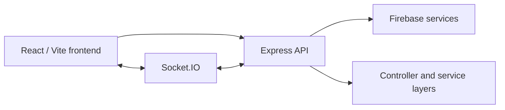

# HostelHive

**A role-based hostel operations and issue-management application.**

HostelHive is a full-stack application for reporting and tracking hostel maintenance issues, coordinating workers, sending notifications, and managing hostels and users. It includes separate student, worker, and administrator screens.

> **Status:** Application source repository. Demo availability, production deployment, and test coverage have not been independently verified as part of this documentation refresh.

## What is implemented in the codebase

- Student-facing issue reporting and issue history.
- Worker task views and issue updates.
- Administrative dashboards for hostels, users, workers and issues.
- Authentication integration, ratings and notifications.
- A chat UI, Socket.IO context, and backend real-time event handling.

## Architecture



## Repository structure

```text
frontend/
  src/pages/        Student, worker and admin views
  src/components/   UI, chat, ratings and notifications
  src/context/      Authentication and socket state
backend/
  src/routes/       HTTP route definitions
  src/controllers/  Request handlers
  src/services/     Application logic
  src/models/       Domain models
  src/config/       Firebase and application configuration
```

## Run locally

Use a modern Node.js LTS release. Install dependencies separately for the backend and frontend.

```bash
# Terminal 1 — backend
cd backend
npm install
npm run dev
```

```bash
# Terminal 2 — frontend
cd frontend
npm install
npm run dev
```

The app depends on Firebase configuration and may require additional service credentials. Review [`backend/src/config/firebase.js`](backend/src/config/firebase.js), [`frontend/src/config/firebase.js`](frontend/src/config/firebase.js), and the API/HTTP client configuration before starting. **No complete example environment configuration is provided in the repository root.** Do not commit service-account keys or private credentials.

The backend exposes a health route under its mounted API router; refer to [`backend/src/routes/index.js`](backend/src/routes/index.js) for the current route definitions.

## Engineering notes

- The codebase separates backend routes, controllers and services.
- React screens are split by user role and share reusable components.
- The frontend contains asynchronous service calls and authentication/Socket.IO contexts.
- A backend test script is configured, but **test pass status has not been verified** in this review.

## What to improve next

Capture real screenshots of the student, worker and administrator flows; add a safe example configuration; run and document tests; and validate the security configuration before production deployment. These are follow-up tasks, **not** completed claims.

---

**Maintainer:** [Alihassan0155](https://github.com/Alihassan0155) · [Portfolio](https://ali-hassan-khan-portfolio.vercel.app/)
